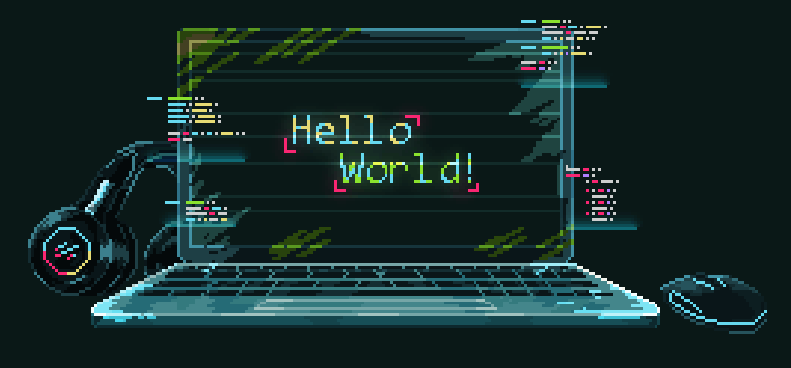

  

<h1 align="center">Abdellah Nsila</h1>

<h3 align="center">Full Stack Developer &nbsp;|&nbsp; Software Engineering Student at 1337 (UM6P)</h3>

  Building secure, scalable web applications, from the database to deployment.

<!-- Row 1: contact links and affiliations -->

  
  
  
  
  
  

<!-- Row 2: profile info -->

  
  
  

  

---

## About

I'm a Full Stack Developer and a Software Engineering student at **1337**, the coding school of **Mohammed VI Polytechnic University (UM6P)** in Ben Guerir, part of the **42 Network**.

1337's project-based, peer-to-peer learning environment gave me a solid foundation in **C/C++ systems programming**, **microservices architecture** and rigorous code review. I build end-to-end web applications with modern frontends (React, Next.js), REST APIs (NestJS, Flask) and containerized CI/CD deployments. I'm now expanding into **machine learning and recommender systems** with Python.

---

## Tech Stack

| Category | Technologies |
|:--|:--|
| **Languages** |         |
| **Frontend** |          |
| **Backend and APIs** |         |
| **Databases** |        |
| **DevOps and Tools** |              |
| **Systems and Graphics** |     |
| **AI and Data** *(learning)* |     |

---

## GitHub Statistics

  
  

  
  

---

## Contact

**Email:** [abdellahnsila42@gmail.com](mailto:abdellahnsila42@gmail.com) &nbsp;|&nbsp; **LinkedIn:** [abdellah-nsila](https://linkedin.com/in/abdellah-nsila-149ba0439) &nbsp;|&nbsp; **Portfolio:** [portfolio-eight-mocha-82.vercel.app](https://portfolio-eight-mocha-82.vercel.app/)
